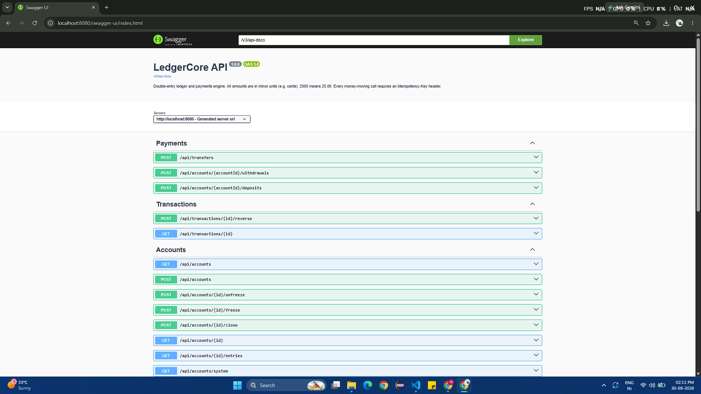
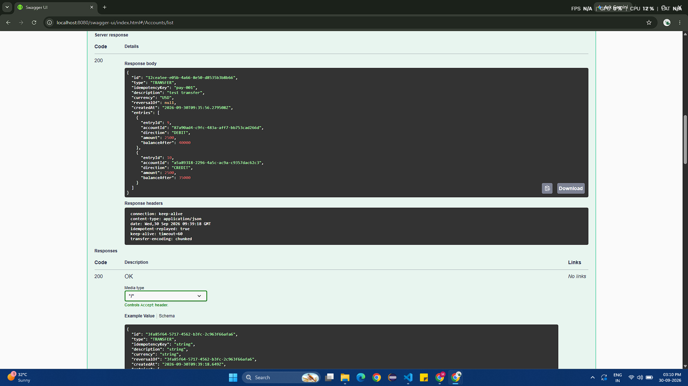
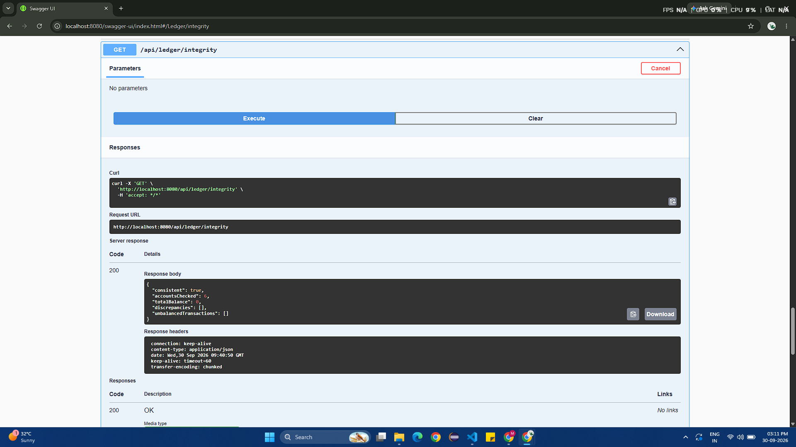
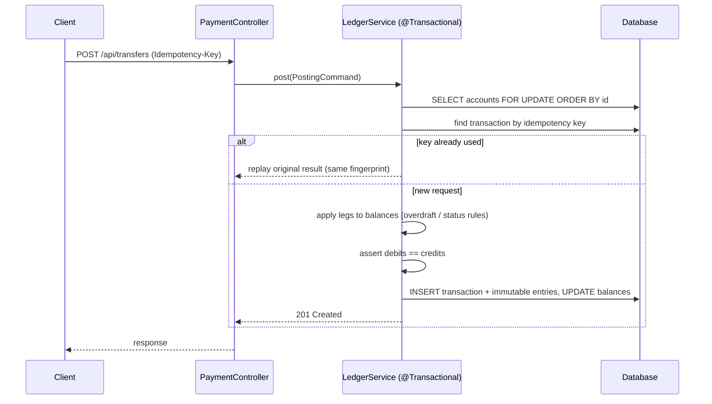

# LedgerCore: Double-Entry Ledger & Payments Engine


**Tech stack:** Java 17 · Spring Boot 3.3 · Hibernate 6 · PostgreSQL · H2 · Docker · GitHub Actions

A small **core-banking style ledger** built with Spring Boot 3 and Hibernate. The ledger itself is
append-only: every movement is an immutable, balanced set of entries, and account balances are a
cached projection that can be reconciled against it. Payments are **idempotent**, concurrent
transfers are **deadlock-free**, and the whole ledger can be **verified** on demand.

It is deliberately focused on the hard parts of financial backends rather than on CRUD.

## Screenshots





## What makes it interesting

| Concern | How it is solved |
|---------|------------------|
| **Double-entry bookkeeping** | Every transaction is a set of `DEBIT`/`CREDIT` entries; `JournalTransaction.assertBalanced()` refuses to persist an unbalanced one. The sum of all balances in the system is always `0`. |
| **Immutable history** | `JournalTransaction` and `LedgerEntry` are Hibernate `@Immutable`. Mistakes are fixed with a compensating `REVERSAL` transaction, never by editing rows. |
| **Idempotent payments** | Every money-moving call needs an `Idempotency-Key`. Retries return the original result (`200` + `Idempotent-Replayed: true`); reusing a key with a different payload is rejected (`409`). A SHA-256 request fingerprint + a DB unique constraint back this up. |
| **Concurrency safety** | Accounts are locked with `SELECT … FOR UPDATE` **in a deterministic order**, so opposing transfers (A→B and B→A) cannot deadlock. `@Version` optimistic locking is a second safety net. |
| **Database-level guarantees** | Hibernate `@Check` constraints make the DB itself reject overdrafts on customer accounts and non-positive amounts. |
| **Reconciliation** | `GET /api/ledger/integrity` (and a scheduled job) verifies, inside a `REPEATABLE_READ` snapshot, that cached balances equal the ledger, every transaction is balanced and the books sum to zero. |
| **Money correctness** | Amounts are `long` minor units (no floating point), with overflow protection via `Math.addExact`. |
| **Concurrency-tested** | An integration test runs 8 threads x 25 opposing transfers and asserts that not a single cent is lost or created. |

## Architecture



**Layers:** `controller` → `service` (`PaymentService` maps business operations to postings, `LedgerService` is the single posting engine) → `repository` → `domain` (rich entities with behaviour).

### The accounting model

- `DEBIT` = value leaves an account, `CREDIT` = value enters it.
- A **transfer** debits one customer and credits another.
- A **deposit** debits the currency's *system clearing account* and credits the customer; a **withdrawal** is the opposite. The clearing account is allowed to go negative, which is exactly what keeps the total of all balances at zero.

## Getting started

**Requirements:** JDK 17+ and Maven 3.9+ (or Docker).

```bash
git clone https://github.com/mateen5172/ledger-core.git
cd ledger-core
mvn spring-boot:run          # in-memory H2, seeded with demo accounts
```

- Swagger UI: http://localhost:8080/swagger-ui.html
- H2 console: http://localhost:8080/h2-console (JDBC URL `jdbc:h2:mem:ledgerdb`, user `sa`)

> The database is in-memory, so data and account IDs reset on every restart.
> Call `GET /api/accounts` to get the IDs of the seeded demo accounts (Alice, Bob, Priya).

```bash
docker compose up --build    # PostgreSQL + the app
mvn verify                   # run all tests
```

## API walkthrough

All amounts are **minor units** (`2500` = 25.00).

The easiest way to try the API is **Swagger UI**. The curl examples below use bash variables
(`$ALICE`, `$BOB`, `$TX_ID`); replace them with real IDs from `GET /api/accounts`.

```bash
# 1. Create two accounts
curl -X POST localhost:8080/api/accounts -H 'Content-Type: application/json' \
     -d '{"ownerName":"Alice","currency":"USD"}'
curl -X POST localhost:8080/api/accounts -H 'Content-Type: application/json' \
     -d '{"ownerName":"Bob","currency":"USD"}'

# 2. Deposit 100.00 into Alice's account
curl -X POST localhost:8080/api/accounts/$ALICE/deposits \
     -H 'Content-Type: application/json' -H 'Idempotency-Key: dep-001' \
     -d '{"amount":10000,"description":"top-up"}'

# 3. Transfer 25.00 to Bob (run it twice: the second call is a harmless replay)
curl -i -X POST localhost:8080/api/transfers \
     -H 'Content-Type: application/json' -H 'Idempotency-Key: pay-001' \
     -d "{\"fromAccountId\":\"$ALICE\",\"toAccountId\":\"$BOB\",\"amount\":2500,\"description\":\"rent\"}"

# 4. Statement, reversal and reconciliation
curl localhost:8080/api/accounts/$ALICE/entries
curl -X POST localhost:8080/api/transactions/$TX_ID/reverse
curl localhost:8080/api/ledger/integrity
```

| Method | Endpoint | Description |
|--------|----------|-------------|
| POST / GET | `/api/accounts`, `/api/accounts/{id}` | Create / read accounts |
| GET | `/api/accounts/{id}/entries` | Paged statement with running balance |
| GET | `/api/accounts/system` | System clearing accounts |
| POST | `/api/accounts/{id}/freeze` · `unfreeze` · `close` | Account lifecycle |
| POST | `/api/accounts/{id}/deposits` · `withdrawals` | Money in / out (needs `Idempotency-Key`) |
| POST | `/api/transfers` | Transfer between accounts (needs `Idempotency-Key`) |
| GET | `/api/transactions/{id}` | Transaction with its ledger entries |
| POST | `/api/transactions/{id}/reverse` | Compensating reversal (safe to repeat) |
| GET | `/api/ledger/integrity` | Full reconciliation report |

Errors use RFC 7807 problem documents: `400` validation, `404` unknown resource, `409` idempotency-key reuse or concurrent conflict, `422` business-rule violation (insufficient funds, frozen account, currency mismatch).

## Project structure

```
src/main/java/com/example/ledger
├── config       # typed properties, OpenAPI, scheduling
├── controller   # REST endpoints
├── domain       # Account, JournalTransaction, LedgerEntry (+ enums)
├── dto          # request/response records
├── exception    # custom exceptions + RFC 7807 handler
├── repository   # Spring Data repositories (locking + reconciliation queries)
├── seed         # clearing-account initializer + demo data
└── service      # LedgerService (posting engine), PaymentService, IntegrityService
```

## Testing

- `AccountTest`: pure unit tests of overdraft, freeze/close and overflow rules.
- `LedgerServiceIntegrationTest`: idempotency, reversals, currency/status rules and a **multi-threaded stress test** against real Hibernate.
- `LedgerApiIntegrationTest`: HTTP-level tests with MockMvc.

## Design trade-offs & next steps

- The per-currency clearing account is a **hot row**: all deposits/withdrawals in a currency serialise on it. At scale it could be sharded into several clearing accounts.
- Cached balances trade a little write cost for O(1) reads; the reconciliation job guards against drift.
- Idempotency keys are global and kept forever; production systems usually scope them per client and expire them.
- Ideas: Flyway migrations, Testcontainers with PostgreSQL, JWT security, multi-currency FX legs, an outbox table + Kafka events, a Micrometer dashboard.

## Author

**Mateen Pasha Patel**: [GitHub](https://github.com/mateen5172)

## License

MIT © Mateen Pasha Patel